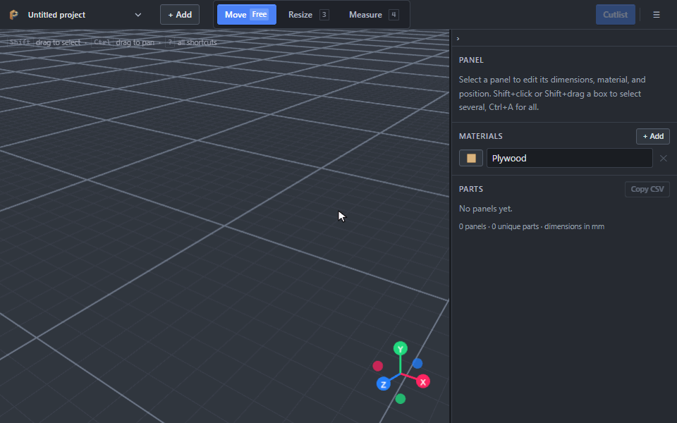

  
  

  # Panelizer

  **A free, fast, browser-based cabinet and plywood designer.**  
  *Turn your ideas into accurate cutlists in minutes.*

  
  
  

   

  

---

Sketch a cabinet in 3D and walk into the shop with a cut diagram five minutes later. Panelizer is built for speed, not to replace full CAD — for parametric modeling, SketchUp or Fusion 360 are the right tools.

## ✨ What it does

- 🛠️ **Design in 3D.** Build your piece from panels: add sides, shelves and backs, then drag them into place. Parts snap together, and Panelizer warns you when two of them overlap.
- 📐 **Work in your units.** Use millimetres, centimetres or inches. Inches show as fractions, like on a tape measure, and you can type math in any field, such as `23 3/4 + 1/2`.
- 🪵 **Get a cutlist.** Tell Panelizer which sheets you have, and it lays your parts out on them with as little waste as possible. It respects the wood grain and the width of your saw blade. Print the layout for the saw, or export it as DXF for a CNC.
- 🎨 **Show it off.** Give each material a finish, like oak, walnut, marble or painted, in any colour. Then open **Present** to see the piece as it will look built, and save a picture for your client.
- 🔗 **Share it.** Send a link that holds the whole design. It opens on a phone too, so you can check sizes and the cutlist in the shop.
- 🔒 **Keep it private.** Everything runs in your browser. There's no account, no server, and nothing is uploaded.

## 🤝 Contributing

Issues and pull requests are welcome. See the [Contributing Guide](CONTRIBUTING.md) to get set up, or [open an issue](https://github.com/pelletier197/panelizer/issues).

## ☕ Support

Panelizer is free and always will be. [Buy me a coffee](https://buymeacoffee.com/pelletier197) if you'd like to support it, and don't forget to [star the repo](https://github.com/pelletier197/Panelizer)!

## 📄 License

[MIT](LICENSE)
